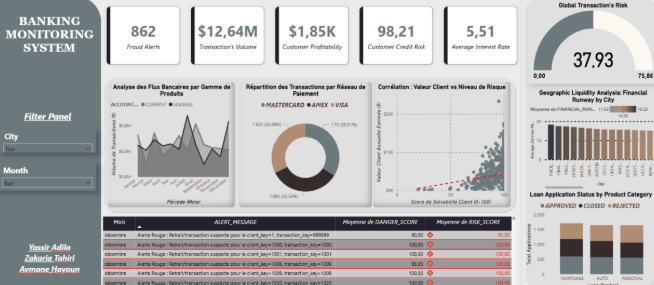

# Banking Data Monitoring System

An academic banking data warehouse and monitoring project built with Oracle SQL/PL/SQL and Power BI. The project transforms raw banking records into cleaned data, a star schema, risk indicators, and dashboard views.



## Architecture

```text
Banking source data / PostgreSQL OLTP
            ↓
BRZ_BANKING_IMPORT (raw landing table)
            ↓  PKG_DATA_CLEANING.SP_CLEAN_STAGING
SLV_BANKING_DATA (typed, cleaned, deduplicated)
            ↓  PKG_BUSINESS_LOGIC.SP_POPULATE_GOLD
DIM_DATE + DIM_CUSTOMER + DIM_PRODUCT + FACT_TRANSACTIONS
            ↓
Power BI dashboard and ALERTS_LOG
```

The report describes PostgreSQL as the operational source, Oracle XE 21c as the data warehouse, Oracle SQL Developer for SQL/PL/SQL work, and Power BI for visualization. The source dataset and PostgreSQL ingestion pipeline are **not included** in this repository.

## Repository contents

| File | Description |
| --- | --- |
| [oracle_project.sql](oracle_project.sql) | Oracle tables, sequences, PL/SQL packages, risk alert trigger, example data, ETL calls, and validation queries. |
| [Oracle_Dashboard.pbix](Oracle_Dashboard.pbix) | Power BI Desktop dashboard. |
| [Rapport.pdf](Rapport.pdf) | Detailed project report (French). |
| [presentation.pdf](presentation.pdf) | Project presentation (French). |
| [demo video.mp4](demo%20video.mp4) | Project demonstration video (stored with Git LFS). |

The demo video is tracked with [Git LFS](https://git-lfs.com/) because it exceeds GitHub's normal 100 MB file limit. Install Git LFS before cloning if you want the video bytes locally. The [source Drive folder](https://drive.google.com/drive/folders/1N36YNO7mub0BtzXyZTqIY4ctsnu3sNJ2) also contains two shortcuts named **Oracle Rapports**; these are links to other Drive items, not standalone files.

## Run the Oracle proof of concept

1. Use Oracle Database XE 21c (or a compatible Oracle version) and open [oracle_project.sql](oracle_project.sql) in Oracle SQL Developer.
2. Run the script as a script so the PL/SQL `/` terminators are processed. It creates the bronze and silver tables, date/customer/product dimensions, transaction fact table, alert log, sequences, packages, and trigger.
3. The script inserts one example record into `BRZ_BANKING_IMPORT`, then calls `PKG_DATA_CLEANING.SP_CLEAN_STAGING`, `PKG_BUSINESS_LOGIC.SP_GEN_CALENDAR`, and `PKG_BUSINESS_LOGIC.SP_POPULATE_GOLD`.
4. Run the validation queries at the end of the script to inspect risk, alerts, and financial health measures.
5. Open [Oracle_Dashboard.pbix](Oracle_Dashboard.pbix) in Power BI Desktop and configure its Oracle connection for your local database. Refresh the data after loading your own source records.

The script includes commented cleanup statements for reruns. Review existing objects before executing them. Real banking data should be anonymized before use in this demonstration.

## Project team

Aymane Hayoun, Zakaria Tahiri, and Yassir Adila. Academic year 2025–2026, École Nationale des Sciences Appliquées de Tétouan.
